<picture>
  <source media="(max-width: 1100px)" srcset="./assets/lex-profile/hero-v4-mobile.svg">
  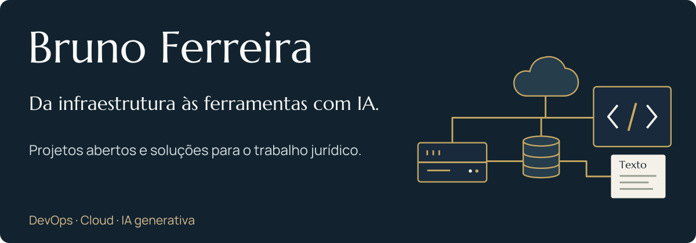
</picture>

**[Projetos abertos](#projetos-abertos) · [Lex Operandi](#ecossistema) · [Tecnologias](#tecnologias) · [Trajetória](#trajetoria) · [Contato](#contato)**

Sou **Bruno Ferreira**. Trabalho há mais de 15 anos com infraestrutura, sistemas, redes e segurança. Hoje aplico essa experiência em **DevOps, Cloud e IA generativa**, criando ferramentas para pesquisa, documentos e produtividade.

Mantenho projetos abertos como **JurisprudênciaIA MCP, Jusmanizer, Claude Session Linker e MD Studio** e desenvolvo as soluções jurídicas do ecossistema **Lex Operandi**.

**[Explore os projetos](#projetos-abertos) · [Conheça a Lex Operandi](#ecossistema) · [Converse comigo](https://www.linkedin.com/in/brunoflma/)**

<a href="https://github.com/brunoflma?tab=repositories">
  <picture>
    <source media="(max-width: 1100px)" srcset="./assets/lex-profile/activity-v4-mobile.svg">
    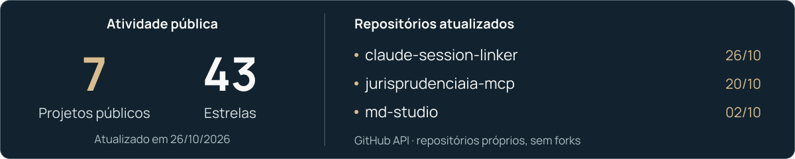
  </picture>
</a>

## Projetos abertos

<a href="https://github.com/brunoflma?tab=repositories">
  <picture>
    <source media="(max-width: 1100px)" srcset="./assets/lex-profile/open-source-v3-mobile.svg">
    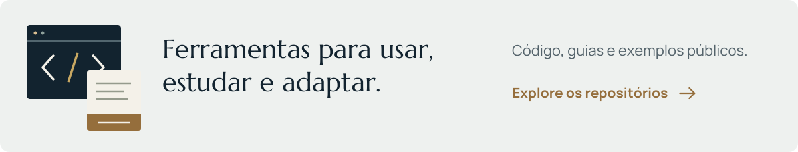
  </picture>
</a>

<a href="https://brunoflma.github.io/jurisprudenciaia-mcp/">
  <picture>
    <source media="(max-width: 1100px)" srcset="./assets/lex-profile/jurisprudenciaia-mobile.svg">
    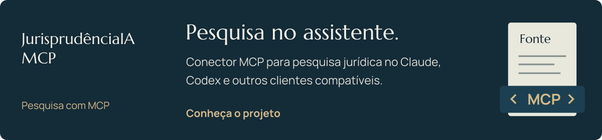
  </picture>
</a>

**[JurisprudênciaIA MCP](https://brunoflma.github.io/jurisprudenciaia-mcp/)** conecta a pesquisa jurídica do serviço JurisprudênciaIA a clientes MCP. O conector cuida da integração e do acesso; a pesquisa é oferecida pelo serviço. [Código e documentação](https://github.com/brunoflma/jurisprudenciaia-mcp).

<a href="https://brunoflma.github.io/jusmanizer/">
  <picture>
    <source media="(max-width: 1100px)" srcset="./assets/lex-profile/jusmanizer-mobile.svg">
    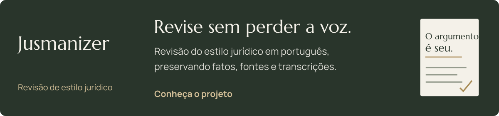
  </picture>
</a>

**[Jusmanizer](https://brunoflma.github.io/jusmanizer/)** é uma skill de revisão do estilo jurídico em português, preservando fatos, fontes, pedidos e transcrições. [Código e exemplos](https://github.com/brunoflma/jusmanizer).

<a href="https://brunoflma.github.io/claude-session-linker/">
  <picture>
    <source media="(max-width: 1100px)" srcset="./assets/lex-profile/session-linker-mobile.svg">
    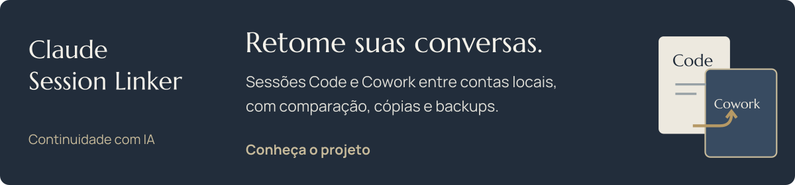
  </picture>
</a>

**[Claude Session Linker](https://brunoflma.github.io/claude-session-linker/)** encontra, vincula e compara sessões Code e Cowork entre contas locais do Claude Desktop, com cópias e backups. [Código e guia de uso](https://github.com/brunoflma/claude-session-linker).

<a href="https://brunoflma.github.io/md-studio/">
  <picture>
    <source media="(max-width: 1100px)" srcset="./assets/lex-profile/md-studio-mobile.svg">
    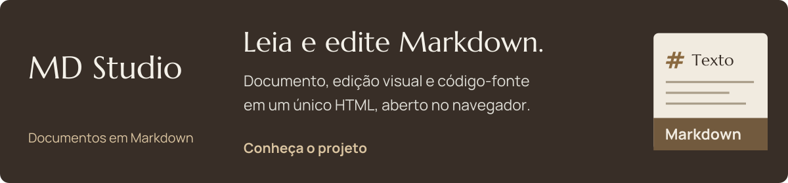
  </picture>
</a>

**[MD Studio](https://brunoflma.github.io/md-studio/)** reúne leitura, edição visual e código-fonte de Markdown em um único HTML, aberto no navegador. [Código e documentação](https://github.com/brunoflma/md-studio).

Também mantenho o **[Context Guardian](https://github.com/brunoflma/context-guardian)**, para preservar decisões e preparar a retomada de conversas longas, e o **[Context Status](https://github.com/brunoflma/context-status)**, para estimar o uso de contexto e acompanhar decisões em conversas com IA.

**[Ver todos os repositórios públicos](https://github.com/brunoflma?tab=repositories)**

## Ecossistema Lex Operandi

<a href="https://lexoperandi.bfldevlabs.studio/">
  <picture>
    <source media="(max-width: 1100px)" srcset="./assets/lex-profile/ecosystem-mobile.svg">
    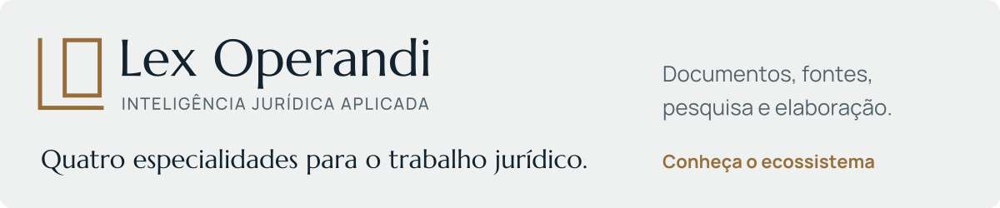
  </picture>
</a>

São quatro produtos independentes. Você escolhe o recurso conforme o trabalho do caso; a revisão e a decisão permanecem com o profissional.

<a href="https://eluxi.bfldevlabs.studio/">
  <picture>
    <source media="(max-width: 1100px)" srcset="./assets/lex-profile/eluxi-mobile.svg">
    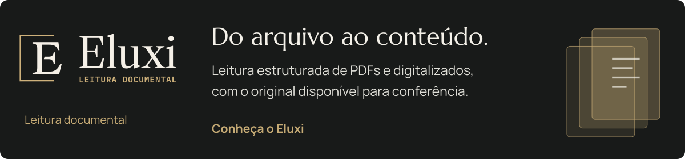
  </picture>
</a>

**[Eluxi](https://eluxi.bfldevlabs.studio/)** prepara a leitura de PDFs e documentos digitalizados, com acesso ao original para conferência.

<a href="https://fons.bfldevlabs.studio/">
  <picture>
    <source media="(max-width: 1100px)" srcset="./assets/lex-profile/fons-mobile.svg">
    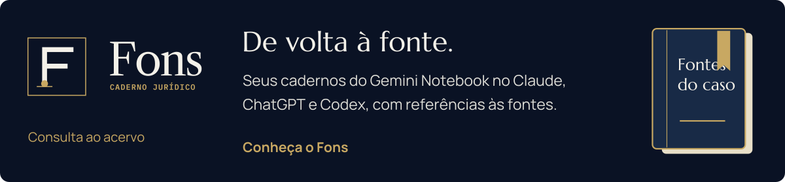
  </picture>
</a>

**[Fons](https://fons.bfldevlabs.studio/)** conecta os cadernos do titular no Gemini Notebook aos assistentes compatíveis para consultar e relacionar fontes.

<a href="https://zetema.bfldevlabs.studio/">
  <picture>
    <source media="(max-width: 1100px)" srcset="./assets/lex-profile/zetema-mobile.svg">
    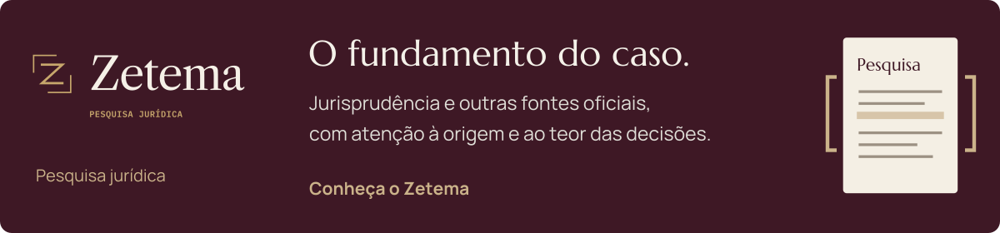
  </picture>
</a>

**[Zetema](https://zetema.bfldevlabs.studio/)** localiza jurisprudência e outras fontes oficiais e apoia a conferência de sua origem e teor.

<a href="https://dissero.bfldevlabs.studio/">
  <picture>
    <source media="(max-width: 1100px)" srcset="./assets/lex-profile/dissero-mobile.svg">
    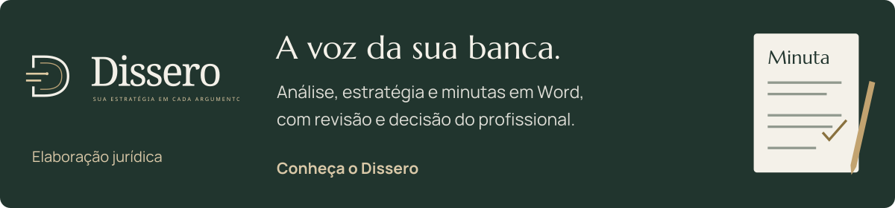
  </picture>
</a>

**[Dissero](https://dissero.bfldevlabs.studio/)** apoia a análise, a estratégia e a elaboração de minutas em Word na voz da banca.

A disponibilidade e as condições de acesso estão na página de cada produto.

## Tecnologias que conectam essas ideias

**Linguagens e interfaces**

  
  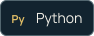
  
  
  

**Cloud e dados**

  
  
  
  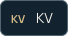
  
  
  

**IA, protocolos e documentos**

  
  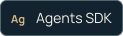
  
  
  
  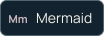
  

**Testes e entrega**

  
  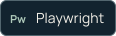
  

## Trajetória

Minha base está na administração de sistemas, redes, servidores e segurança. A automação conecta essa experiência ao desenvolvimento de ferramentas com cloud e IA.

Experiência e certificações

Ao longo dessa trajetória, obtive certificações como **AWS Cloud Practitioner**, **Google Cloud Digital Leader**, **Azure Fundamentals**, **ITIL** e **Scrum Fundamentals**. Os detalhes estão no meu [LinkedIn](https://www.linkedin.com/in/brunoflma/).

## Vamos conversar

Para conversar sobre DevOps, Cloud, IA generativa ou ferramentas para o trabalho jurídico, [me encontre no LinkedIn](https://www.linkedin.com/in/brunoflma/).

Sugestões, dúvidas de uso e contribuições são bem-vindas nas issues de cada projeto.
