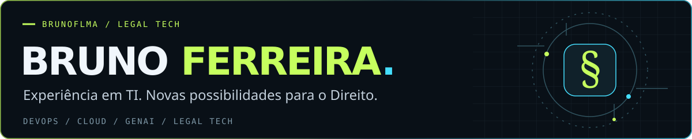
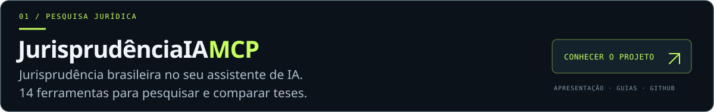
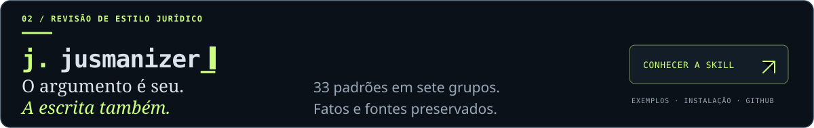
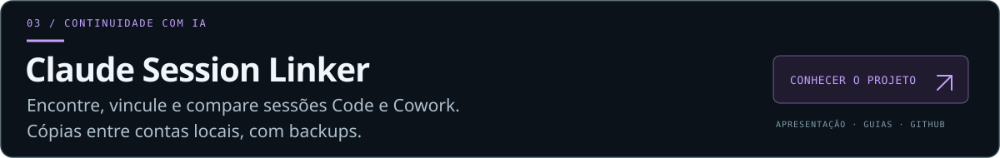
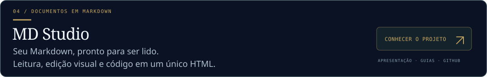
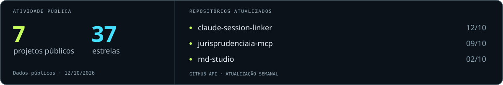

<picture>
  <source media="(max-width: 600px)" srcset="./assets/hero-mobile.svg">
  
</picture>

**[Projetos](#projetos) · [Tecnologias](#tecnologias) · [Trajetória](#trajetoria) · [Contato](#contato)**

### Da infraestrutura à IA aplicada ao Direito.

Sou **Bruno Ferreira**, profissional de TI com **mais de 15 anos de experiência** em infraestrutura, sistemas, redes e segurança. 

Hoje direciono essa trajetória para **DevOps, Cloud e IA Generativa**, com foco crescente em soluções para o trabalho jurídico.

Minha atuação em **legal tech** parte de tarefas concretas: levar a pesquisa de jurisprudência para os assistentes de IA, aprimorar a revisão de textos jurídicos e organizar o trabalho com documentos. 

É nessa frente que desenvolvo o **JurisprudênciaIA MCP**, com 14 ferramentas para pesquisa jurídica, e o **Jusmanizer**, com 33 padrões de revisão de estilo em português. O **Claude Session Linker** ajuda a retomar conversas entre contas locais, e o **MD Studio** reúne leitura e edição de Markdown no navegador.

  
  

#### Quatro projetos para conhecer de perto

  <a href="https://brunoflma.github.io/jurisprudenciaia-mcp/" title="Conhecer o JurisprudênciaIA MCP">
    <picture>
      <source media="(max-width: 600px)" srcset="./assets/projects/jurisprudenciaia-mobile.svg">
      
    </picture>
  </a>

  <a href="https://brunoflma.github.io/jusmanizer/" title="Conhecer o Jusmanizer">
    <picture>
      <source media="(max-width: 600px)" srcset="./assets/projects/jusmanizer-mobile.svg">
      
    </picture>
  </a>

  <a href="https://brunoflma.github.io/claude-session-linker/" title="Conhecer o Claude Session Linker">
    <picture>
      <source media="(max-width: 600px)" srcset="./assets/projects/session-linker-mobile.svg">
      
    </picture>
  </a>

  <a href="https://brunoflma.github.io/md-studio/" title="Conhecer o MD Studio">
    <picture>
      <source media="(max-width: 600px)" srcset="./assets/projects/md-studio-mobile.svg">
      
    </picture>
  </a>

  <a href="https://github.com/brunoflma?tab=repositories" title="Ver todos os projetos públicos">
    <picture>
      <source media="(max-width: 600px)" srcset="./assets/showcase-mobile.svg">
      
    </picture>
  </a>

#### Tecnologias que conectam essas ideias

  
  
  
  
  
  

Integrações com **Claude, ChatGPT e Codex**, APIs e instruções reutilizáveis para assistentes de IA.

| Na prática | Tecnologias nos projetos |
| :--- | :--- |
| Conectar assistentes a serviços e ferramentas | TypeScript, JavaScript, MCP e Cloudflare Workers |
| Automatizar tarefas e organizar sessões | Python |
| Criar interfaces para leitura e edição de documentos | HTML, CSS e JavaScript |

<strong>Por dentro dos quatro projetos em destaque</strong>

**[JurisprudênciaIA MCP](https://github.com/brunoflma/jurisprudenciaia-mcp)** — conector em Cloudflare Workers com **14 ferramentas** para pesquisar jurisprudência, precedentes e informativos, analisar teses e comparar duas teses na mesma conversa. Funciona com Claude, Codex e outros clientes MCP. O projeto cuida da integração e do acesso; o serviço de pesquisa é o JurisprudênciaIA. [Veja o catálogo e o guia de conexão](https://brunoflma.github.io/jurisprudenciaia-mcp/).

**[Jusmanizer](https://github.com/brunoflma/jusmanizer)** — skill aberta de revisão de estilo jurídico em português, com **33 padrões em sete grupos**, exemplos práticos e prompts para a rotina da advocacia. Orienta o assistente a retirar excessos e repetições de petições, recursos, pareceres, minutas contratuais e comunicações, preservando fatos, nomes, valores, datas, pedidos, fontes e transcrições. [Veja as demonstrações](https://brunoflma.github.io/jusmanizer/).

**[Claude Session Linker](https://github.com/brunoflma/claude-session-linker)** — interface local para encontrar, vincular e comparar sessões **Code e Cowork** do Claude Desktop entre contas no mesmo computador. Cria cópias locais e mantém backups antes das alterações; as sessões Code podem continuar de forma independente em cada conta. [Conheça o fluxo e os cuidados de uso](https://brunoflma.github.io/claude-session-linker/).

**[MD Studio](https://github.com/brunoflma/md-studio)** — **leitura, edição visual e código-fonte** de Markdown em um único arquivo HTML, aberto no navegador. Permite trabalhar diretamente no documento renderizado ou ajustar a sintaxe no código antes de salvar. [Explore os modos e o documento de exemplo](https://brunoflma.github.io/md-studio/#comecar).

<strong>Outras ferramentas para acompanhar o contexto da IA</strong>

| Projeto | Para que serve |
| :--- | :--- |
| **[Context Guardian](https://github.com/brunoflma/context-guardian)** | Preservar decisões e preparar a retomada de conversas longas com IA. |
| **[Context Status](https://github.com/brunoflma/context-status)** | Estimar o uso de contexto e acompanhar decisões em conversas com IA. |

#### Trajetória e certificações

<strong>Da infraestrutura ao desenvolvimento de ferramentas com IA</strong>

Minha base profissional está na infraestrutura de TI: administração de sistemas, redes, servidores e segurança. 

A automação e a cultura DevOps conectam essa experiência ao trabalho atual com cloud e IA generativa.

Ao longo dessa trajetória, obtive certificações como **AWS Cloud Practitioner**, **Google Cloud Digital Leader**, **Azure Fundamentals**, **ITIL** e **Scrum Fundamentals**. Os detalhes estão no meu [LinkedIn](https://www.linkedin.com/in/brunoflma/).

Compartilhar conhecimento faz parte de como aprendo e trabalho.

#### Vamos conversar

DevOps, Cloud, IA generativa e ferramentas para o trabalho jurídico são os temas que conectam meus projetos.

**[Fale comigo pelo LinkedIn ↗](https://www.linkedin.com/in/brunoflma/)**

Para dúvidas de uso, sugestões ou contribuições, abra uma issue no repositório do projeto correspondente.
